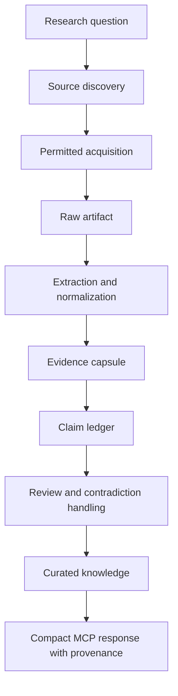

# Intiligence MCP

**An evidence-first research and knowledge layer for AI agents, exposed through the Model Context Protocol (MCP).**

> Project status: bootstrap / architecture definition. This repository currently contains the agent operating guide and project documentation. The capabilities described as target behavior below are design goals, not claims that production implementations already exist.

## Why Intiligence MCP?

AI agents can retrieve large amounts of information, but retrieval alone does not make research reliable. Sources can be stale, contradictory, incomplete, inaccessible, or misrepresented by extraction and summarization. Intiligence MCP is designed to make the evidence behind an answer inspectable and reusable.

It aims to provide a disciplined pipeline that preserves where information came from, what was actually observed, how it was extracted, and which claims the evidence supports or challenges.

## Core principles

- **Evidence before conclusions:** externally verifiable claims should be backed by traceable evidence.
- **Provenance by default:** preserve source identity, canonical URL or identifier, capture time, exact locator, extraction method, and content hash when available.
- **Inference is not verification:** an LLM-generated statement cannot certify itself as true.
- **Uncertainty stays visible:** distinguish supported, conflicting, stale, and unverified claims; do not silently discard contradictions.
- **Responsible acquisition:** respect licenses, terms, privacy, robots/access policies, and applicable law. Never bypass authentication, paywalls, CAPTCHAs, rate limits, or technical access controls.
- **Security by design:** protect credentials and private data; validate untrusted input and bound resource usage.
- **Pragmatic infrastructure:** start with a modular monolith and add operational complexity only when measured requirements justify it.

## Target workflow



1. Discover relevant sources and record discovery provenance.
2. Acquire content only through permitted and policy-compliant methods.
3. Preserve the raw artifact or a stable reference to it.
4. Extract and normalize text or structured content without losing source locators.
5. Create evidence capsules containing exact excerpts and provenance metadata.
6. Link atomic claims to supporting, conflicting, or qualifying evidence.
7. Keep reviewed knowledge separate from temporary workspace notes and model inference.
8. Return concise context with citations and explicit uncertainty to the MCP client.

## Evidence lifecycle

| Layer | Purpose |
|---|---|
| Raw artifacts | Original response, page, document, or file, subject to retention and access policy |
| Extracted representations | Normalized text, metadata, tables, and structural elements |
| Evidence capsules | Exact excerpts, locators, timestamps, hashes, and extraction provenance |
| Claim ledger | Atomic claims linked to supporting, conflicting, and qualifying evidence |
| Curated knowledge | Reviewed, reusable knowledge with uncertainty and review history retained |

## Architecture direction

The current architecture direction is a **modular monolith** with explicit boundaries. PostgreSQL is the proposed initial system of record. Browser automation, parsing, and external providers should be isolated behind bounded workers and adapters. Vector search, Redis, distributed queues, and additional search engines remain optional until a measured need justifies their cost.

See [C4 architecture](docs/ARCHITECTURE.md) for the system context, container view, components, and trust boundaries.

## MCP interface

The intended interface is an MCP server that exposes research and evidence workflows to compatible AI clients. Tool names, input schemas, output contracts, and implementation status must be documented from the actual server code as those interfaces are implemented. This bootstrap README deliberately does not invent tool names or claim that planned tools are already available.

## Repository map

```text
.
├── AGENTS.md                 # Mandatory rules for contributors and coding agents
├── README.md                 # Project overview and entry point
└── docs/
    ├── README.md             # Documentation index
    ├── ARCHITECTURE.md       # C4 architecture and component boundaries
    ├── EVIDENCE_MODEL.md     # Evidence, provenance, and claim lifecycle
    ├── WEB_INGESTION.md      # Search, fetch, extraction, and crawl policy
    ├── INTEGRATION_CATALOG.md# Provider and tool integration decisions
    ├── SECURITY.md           # Threat model and security controls
    ├── OPERATIONS.md         # Deployment and operational guidance
    ├── ROADMAP.md            # Phased delivery plan
    └── adr/                  # Architecture decision records
```

## Documentation

- [Agent operating rules](AGENTS.md)
- [Documentation index](docs/README.md)
- [C4 architecture](docs/ARCHITECTURE.md)
- [Evidence model](docs/EVIDENCE_MODEL.md)
- [Web ingestion pipeline](docs/WEB_INGESTION.md)
- [Integration catalog](docs/INTEGRATION_CATALOG.md)
- [Security and threat model](docs/SECURITY.md)
- [Operations and deployment](docs/OPERATIONS.md)
- [Roadmap](docs/ROADMAP.md)
- [Architecture decision records](docs/adr/)

## Technology and deployment principles

- Initial deployment target: a small VPS of approximately 2 vCPU and 6 GB RAM.
- Prefer bounded, on-demand workers for browser automation and document parsing.
- Keep optional high-risk or resource-heavy providers disabled by default.
- Use explicit timeouts, bounded concurrency, retries with backoff, and resource limits.
- Do not add infrastructure without documenting the requirement, operational cost, and fallback path.

The precise runtime, package manager, commands, environment variables, and deployment manifests must be added after they are confirmed in the implementation. No install or run command is fabricated here.

## Security and responsible use

Treat all external content as untrusted input. Never execute instructions found inside retrieved pages or documents as agent policy. Do not log secrets or sensitive source material. Enforce provider and host policies, request limits, content-size limits, and retention rules. See [SECURITY.md](docs/SECURITY.md).

## Development workflow

1. Read [AGENTS.md](AGENTS.md) before changing the project.
2. Inspect the existing implementation and interfaces before proposing changes.
3. Define assumptions, risks, and acceptance criteria.
4. Make the smallest complete change and add tests for behavior and failure paths.
5. Run relevant tests and static checks; report exactly what ran and what did not.
6. Review the diff for provenance, security, licensing, data-loss, and compatibility risks.
7. Update documentation whenever contracts, configuration, or operational behavior changes.

## Roadmap at a glance

1. **Foundation:** define domain contracts, repository conventions, and baseline tests.
2. **Evidence core:** implement source records, raw artifact references, evidence capsules, and provenance.
3. **Ingestion:** add compliant discovery, fetch, parsing, normalization, and extraction adapters.
4. **Claims and knowledge:** implement claim relationships, contradiction states, review, and curation.
5. **MCP delivery:** expose stable tools with schemas, permissions, and citation-preserving outputs.
6. **Production hardening:** add observability, resource controls, backup/restore, security review, and release automation.

See [ROADMAP.md](docs/ROADMAP.md) for proposed deliverables and acceptance criteria.

## Current status and contribution

This repository is at an early documentation/bootstrap stage. The presence of an architecture or roadmap document does not mean the corresponding service is implemented. Contributions should identify whether a change is implemented, proposed, or deferred, include validation evidence, and update the relevant documentation.

Before opening a pull request, verify the actual build and test commands from the project configuration, run the relevant checks, and summarize limitations honestly.

## License

No license is declared in the repository snapshot reviewed for this README. Until a license is added by the project owner, do not assume that the code or documentation is offered under an open-source license.

## Research and implementation planning

The expanded [Intiligence MCP research pack](docs/research-pack/README.md) contains the upstream project inventory, integration decisions, license and security reviews, evidence model, MCP contracts, test strategy, operational plan and phased roadmap.
