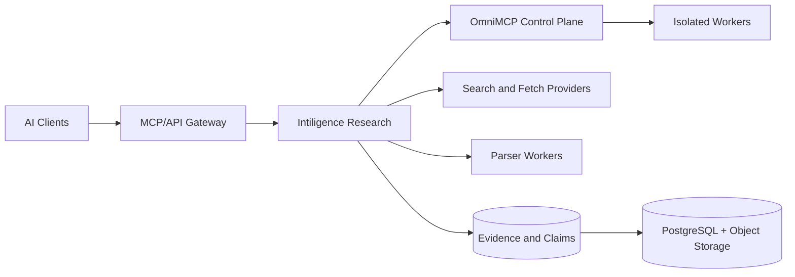

# Intiligence MCP — C4 Architecture

## C1 System Context
Researchers and AI clients use Intiligence for web/deep-web research, document intelligence, defensive OSINT/CTI and evidence-backed reporting. OmniMCP remains the execution control plane.

## C2 Containers
- MCP/API boundary: authentication, tenant binding, schemas, budgets and policy gates.
- Research orchestrator: plan, provider selection, cancellation and review.
- Search/fetch adapters: official APIs, SearXNG, HTTPX, browser workers.
- Parser workers: Docling, OCR and structured extraction.
- Evidence service: immutable captures, excerpts, locators and hashes.
- Claim ledger/knowledge curator: support, conflict, freshness and reviewed knowledge.
- OmniMCP: existing agents, workers, jobs, workspaces and storage.
- PostgreSQL: canonical metadata and evidence; object storage for artifacts; optional Qdrant derived index.

## C3 Components
SearchRouter, SourcePolicyEngine, FetchService, BrowserProvider, ParserRegistry, EvidenceCapsuleService, ClaimLedger, KnowledgeCurator, MCPToolRegistry, OmniMCPClient, AuditPublisher.

## C4 Pipeline
Question → authorization/policy → discovery → acquisition → raw artifact → extraction → evidence capsule → claim graph → review → cited answer.

## Trust boundaries
External content is hostile input. Browser/parser workers have no secrets and restricted egress. Private connectors require least-privilege credentials. Every read/write is tenant-scoped. High-risk side effects require approval.

## Mermaid

Keep a modular monolith initially; execute CPU/network-heavy work as bounded OmniMCP jobs. Do not introduce multiple gateways, schedulers or vector stores without benchmarks.