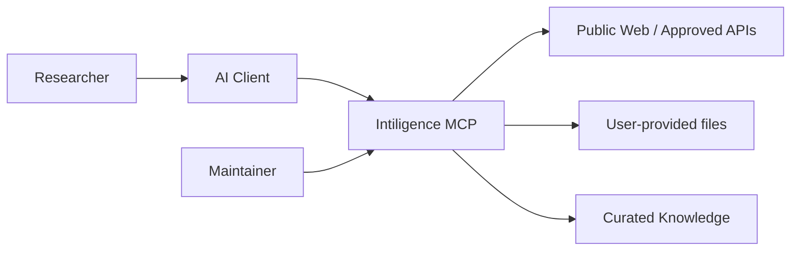
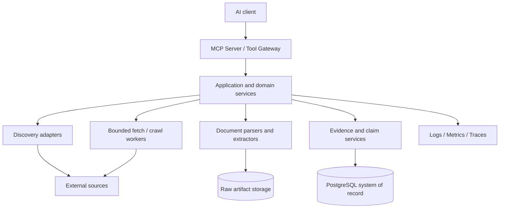
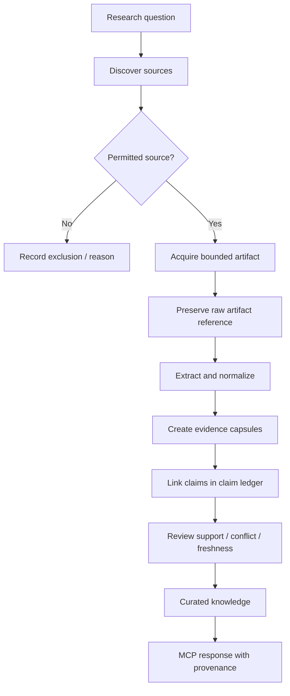

# C4 Architecture — Intiligence MCP

**Status:** Target design, not proof that components exist in code. The repository agent guide is authoritative for architectural constraints.

## C4 Level 1 — System context

Intiligence MCP is an evidence-first research and knowledge service. An AI client asks a research question; the service discovers and acquires permitted sources, extracts content, preserves evidence and provenance, and returns source-grounded context through MCP.

## C4 Level 2 — Container view

## C4 Level 3 — Component responsibilities

| Component | Responsibility |
|---|---|
| MCP interface | Stable tool schemas, validation, transport, error contracts |
| Research orchestrator | Coordinates discovery, acquisition, extraction, evidence, and response |
| Source registry | Canonical source identity, access scope, provider and policy metadata |
| Discovery adapters | Find candidate sources and retain discovery provenance |
| Acquisition workers | Fetch permitted content with timeouts, limits, and host policies |
| Extraction adapters | Parse supported content while retaining source locators |
| Evidence capsule service | Immutable excerpt-level evidence with provenance |
| Claim ledger | Atomic claims and supporting, conflicting, qualifying evidence |
| Knowledge curator | Promotes reviewed claims while preserving uncertainty and history |
| Context composer | Returns compact context with citations and status labels |

## C4 Level 4 — Evidence pipeline

## Trust boundaries

- MCP caller input is untrusted and must be validated and authorized.
- Retrieved pages, documents, snippets, and tool outputs are untrusted data, never agent instructions.
- Provider credentials remain in secret storage and never enter prompts or logs.
- Parsing and browser execution occur in bounded workers; optional high-risk providers remain disabled by default.
- Curated knowledge is distinct from transient model inference and workspace notes.

## Initial deployment direction

Use a modular monolith and PostgreSQL as the initial system of record. Keep parsing and browser work on-demand and bounded. Add vector search, Redis, queues, or external search engines only after profiling demonstrates a requirement. The initial resource target is approximately 2 vCPU and 6 GB RAM.

## Implementation status

These diagrams describe the intended system. Do not mark a component implemented until source code, tests, and operational evidence confirm it.
